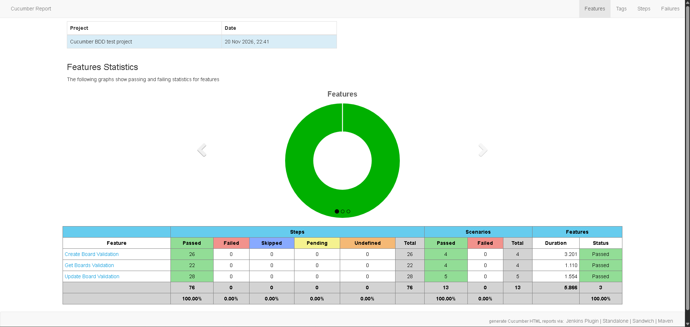

# Trello API Test Automation Framework

[](https://github.com/FadyRiad/trello-api-automation-framework/actions/workflows/ci.yml)

API test automation framework for the [Trello REST API](https://developer.atlassian.com/cloud/trello/rest/), built with **Java 17, REST Assured, JUnit 5 and Cucumber (BDD)** and executed on every push by **GitHub Actions**.

The suite covers the **Boards** and **Cards** resources end to end, with emphasis on negative and validation testing (missing or invalid credentials, malformed IDs, invalid request bodies) alongside the happy paths. Responses are checked for status codes, body values and structure (JSON Schema).

---

## Highlights

- **54 automated tests, 0 failures** (JUnit 5), plus **13 BDD scenarios / 76 steps, all passing** (Cucumber).
- **Two test styles on top of one shared core:** plain JUnit 5 tests and Gherkin scenarios reuse the same endpoint constants and request setup.
- **Data-driven validation:** custom JUnit 5 `ArgumentsProvider` + holder classes keep test data out of the test logic.
- **Contract testing:** response bodies are validated against JSON Schemas.
- **Continuous integration:** GitHub Actions runs the full suite on every push and pull request and publishes the HTML reports as build artifacts.
- **Two HTML reports** per run: Gradle's JUnit report and a Cucumber HTML report.

---

## Coverage

| Resource | Operation | JUnit 5 | Cucumber |
|----------|-----------|:-------:|:--------:|
| Boards | Create | ✅ | ✅ |
| Boards | Get (all / by ID) | ✅ | ✅ |
| Boards | Update | ✅ (validation) | ✅ |
| Boards | Delete | ✅ | |
| Cards | Create | ✅ | |
| Cards | Get | ✅ | |
| Cards | Update | ✅ | |
| Cards | Delete | ✅ | |

**Test counts by operation (JUnit 5)**

| Operation | Tests |
|-----------|------:|
| Create | 13 |
| Get | 13 |
| Update | 9 |
| Delete | 2 |
| Cucumber runner | 17 (13 scenarios + 4 feature-level entries) |
| **Total** | **54** |

**Types of checks**

- **Positive flows:** status code, response body values, JSON Schema validation.
- **Authentication:** missing key, missing token, invalid key, invalid token.
- **Path parameters:** invalid, malformed and non-existent board and card IDs.
- **Request bodies:** blank names, invalid field types, missing required fields.

---

## Tech Stack

| Area | Technology |
|------|-----------|
| Language | Java 17 |
| Build tool | Gradle 9 |
| HTTP client / assertions | REST Assured 4.4.0 |
| Schema validation | REST Assured `json-schema-validator` 4.4.0 |
| Test framework | JUnit 5.10 (Jupiter API, Engine, Params) |
| BDD | Cucumber 7.15 (`cucumber-java`, `cucumber-junit-platform-engine`) |
| Dependency injection for steps | `cucumber-picocontainer` |
| Suite runner | JUnit Platform Suite Engine |
| Reporting | JUnit HTML report and Cucumber HTML report (Gradle plugin) |
| CI | GitHub Actions |

---

## Project Structure

```text
rest_assured_test/
├── .github/workflows/ci.yml   # CI pipeline (GitHub Actions)
├── build.gradle
├── settings.gradle
└── src/test
    ├── java
    │   ├── arguments
    │   │   ├── holders        # Data carriers for parameterized tests
    │   │   └── providers      # JUnit 5 ArgumentsProviders (test data)
    │   ├── base
    │   │   └── BaseTest.java  # Shared request setup (with / without auth)
    │   ├── consts             # Endpoints and shared constants
    │   ├── steps              # Cucumber step definitions
    │   │   ├── TrelloApiActionSteps.java   # "When" steps: build and send requests
    │   │   ├── TrelloApiAssertSteps.java   # "Then" steps: assert responses
    │   │   ├── ScenarioContext.java        # Shares state between steps
    │   │   ├── MapTransformer.java         # DataTable to Map conversion
    │   │   └── StepArgumentsTransformer.java
    │   ├── test               # JUnit tests grouped by operation
    │   │   ├── create
    │   │   ├── get
    │   │   ├── update
    │   │   └── delete
    │   └── TestRunner.java    # Cucumber suite entry point
    └── resources
        ├── features           # Gherkin feature files (create / get / update)
        └── schemas            # JSON schemas for response validation
```

---

## Design Notes

**Separation of data and logic.** Test classes only describe *what* is verified. Request paths live in `BoardsEndpoints` / `CardsEndpoints`, shared values in `UrlParamValues`, and validation datasets in the `arguments` package. Adding a new negative case means adding one entry to a provider, not writing a new test.

**Parameterized validation tests.** Each validation test is fed by an `ArgumentsProvider` that returns holder objects containing the input, the expected status code and the expected error message. One test method covers an entire matrix of cases.

**Reusable BDD steps.** Cucumber steps are generic (`a request with authorization`, `the request is sent to endpoint`, `the response status code is`, `the response body is equal to`) and driven by data tables, so new scenarios can be written in Gherkin without new Java code. `ScenarioContext` is shared through PicoContainer to pass the response between steps.

---

## Running the Tests

**Prerequisites**

- JDK 17

**Run everything**

```bash
./gradlew test
```

The Cucumber HTML report is generated automatically after the test task finishes.

### Test account configuration

The suite runs against a personal Trello test account. The API key, token and the IDs of the test board, list and cards are defined in `src/test/java/consts/UrlParamValues.java`.

To run it against your own Trello account:

1. Get an API key and token from the [Trello Power-Ups admin](https://trello.com/power-ups/admin).
2. Replace `VALID_KEY` and `VALID_TOKEN` in `UrlParamValues.java`.
3. Replace the board, list and card IDs (`EXISTING_BOARD_ID`, `EXISTING_LIST_ID`, `EXISTING_CARD_ID`, `CARD_ID_TO_UPDATE`) and `USER_NAME` with resources from your workspace.

> If the tests fail with `401 Unauthorized`, the token has expired or been revoked. Generate a new one and update `UrlParamValues.java`.

---

## Continuous Integration

The pipeline is defined in [`.github/workflows/ci.yml`](.github/workflows/ci.yml) and runs on every push to `main` and on every pull request.

| Step | What it does |
|------|--------------|
| Checkout | Fetches the repository |
| Set up JDK 17 | Installs Temurin 17 |
| Set up Gradle | Configures Gradle with dependency caching |
| Run tests | Executes `./gradlew test` (JUnit 5 and Cucumber) |
| Upload test reports | Publishes the JUnit and Cucumber HTML reports as the `test-reports` artifact, even when tests fail |

**To view a CI run:**

1. Open the **Actions** tab of the repository.
2. Select the latest run of the **CI** workflow.
3. Download the `test-reports` artifact from the **Artifacts** section at the bottom of the run summary.

---

## Reports

| Report | Location |
|--------|----------|
| JUnit / Gradle test report | `build/reports/tests/test/index.html` |
| Cucumber HTML report | `build/cucumber-report/cucumber-html-reports/` |

The same reports are available for every CI run as downloadable artifacts.

### Latest run

| | Result |
|---|---|
| JUnit 5 tests | 54 executed, 0 failed |
| Cucumber features | 3 passed |
| Cucumber scenarios | 13 passed, 0 failed |
| Cucumber steps | 76 passed, 0 failed, 0 skipped, 0 undefined |
| Total duration | about 24 s |

**Cucumber report**



**Gradle test summary**


---

## Author

**Fady Riad**, QA Automation Engineer / SDET
[LinkedIn](https://www.linkedin.com/in/fadyriadshokrallah/)
